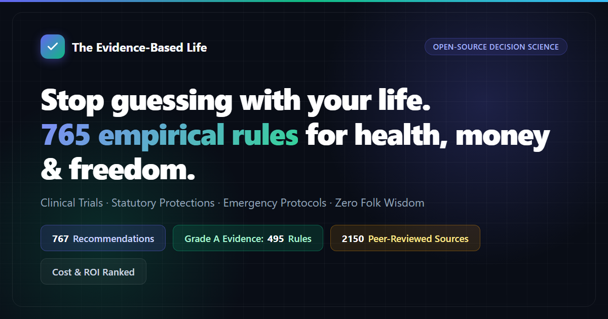

<div align="center">

<a href="https://parveen0029.github.io/The-Evidence-Based-Life/">
  
</a>

# The Evidence-Based Life

**Stop guessing with your life. 767 recommendations for health, money, legal boundaries, and emergency survival.**

*Every rule specifies the exact costs incurred (money, time, willpower), the measured return on investment, and primary citations from peer-reviewed clinical trials and statutory law. Zero folk wisdom. Zero marketing hype.*

[](https://github.com/parveen0029/The-Evidence-Based-Life/stargazers)
[](https://parveen0029.github.io/The-Evidence-Based-Life/)
[](#chapters)
[](#evidence-grading)
[](docs/verification-records/)
[-8b5cf6?style=flat-square&logo=anthropic&logoColor=white)](https://www.agensi.io/skills/evidence-based-life-decision-engine)
[](#license)

<p align="center">
  <a href="https://parveen0029.github.io/The-Evidence-Based-Life/"><b>🚀 Interactive Web App</b></a> &nbsp;•&nbsp;
  <a href="https://parveen0029.github.io/The-Evidence-Based-Life/selfcheck.html"><b>📝 2-Min Self-Audit</b></a> &nbsp;•&nbsp;
  <a href="https://www.agensi.io/skills/evidence-based-life-decision-engine"><b>⚡ Agensi Skill ($15)</b></a> &nbsp;•&nbsp;
  <a href="https://github.com/parveen0029/The-Evidence-Based-Life/releases/download/epub-latest/The-Evidence-Based-Life.pdf"><b>📥 Download PDF</b></a> &nbsp;•&nbsp;
  <a href="https://github.com/parveen0029/The-Evidence-Based-Life/releases/download/epub-latest/The-Evidence-Based-Life.epub"><b>📱 EPUB</b></a> &nbsp;•&nbsp;
  <a href="https://github.com/parveen0029/The-Evidence-Based-Life/releases/download/epub-latest/The-Evidence-Based-Life.html"><b>💾 Single-File HTML (Offline)</b></a> &nbsp;•&nbsp;
  <a href="the-evidence-based-life.json"><b>📊 Open Dataset (JSON)</b></a> &nbsp;•&nbsp;
  <a href="the-evidence-based-life.csv"><b>📈 Spreadsheet (CSV)</b></a> &nbsp;•&nbsp;
  <a href="skills/life-decision-guide/README.md"><b>🤖 AI Decision Skill</b></a>
</p>

</div>

> [!TIP]
> ⭐ **Find this guide useful?** Star this repository in the upper-right corner! Every star helps more people make life decisions based on empirical science rather than hearsay.

---

## ⚡ Did You Know? (Empirical Facts Backed by Science)

Most popular advice is either outdated folk belief or commercial advertising. Here are a few counter-intuitive realities verified across clinical cohorts and statutory law:

- 🚗 **Cold meds impair driving worse than alcohol**: Taking common OTC allergy or cold medicine containing diphenhydramine degrades steering control and brake response time more severely than driving legally drunk at 0.10% blood alcohol. ([Ch 34, Rule 12](book/34-safe-home-medication.md#12-do-not-drive-work-at-heights-or-operate-machinery-while-taking-cold-or-allergy-medications-containing-chlorpheniramine-or-diphenhydramine))
- 🛁 **Hot baths & saunas after drinking can be fatal**: Alcohol dilates peripheral vessels; pairing it with hot water causes acute blood pressure drops and fainting. This is the #1 domestic cause of adult bathtub drowning deaths. ([Ch 22, Rule 11](book/22-science-backed-relaxation.md#11-do-not-use-hot-springs-saunas-or-hot-baths-after-drinking-alcohol))
- 🧂 **A $1 kitchen swap for 12% lower mortality**: Switching normal table salt to a potassium-enriched blend reduced stroke by 14% and all-cause death by 12% in a randomized trial of 20,995 people—for pennies a month with zero extra effort. ([Ch 02, Rule 9](book/02-preventing-chronic-decline.md#9-switch-household-salt-to-low-sodium-potassium-rich-salt))
- 👶 **Baby walkers delay independent walking**: Wheeled infant walkers prevent crucial balance reflexes, cause over 230,000 emergency hospital visits, and have been banned by law in Canada since 2004. ([Ch 20, Rule 15](book/20-newborn-survival-guide.md#15-do-not-buy-wheeled-infant-walkers-replace-them-with-stationary-activity-centers-without-wheels-or-playpens))
- 💼 **Unsigned job contract? Demand double wages**: If an employer delays signing your written labor contract past 30 days of starting work, statutory law entitles you to claim double monthly wages for up to 11 months. ([Ch 19, Rule 20](book/19-workplace-rights-and-injuries.md#20-if-an-employer-fails-to-execute-a-written-employment-contract-after-one-month-demand-double-wages-starting-from-the-second-month-capped-at-11-months-after-one-year-an-open-ended-contract-is-legally-established))
- 🏥 **Hospital bill audits save thousands**: Requesting daily itemized inpatient bill statements before discharge and auditing billing codes routinely uncovers billing errors and cuts self-pay expenses by 20% to 50%. ([Ch 24, Rule 15](book/24-navigating-healthcare.md#15-audit-inpatient-itemized-billing-statements-line-by-line-verify-uninsured-self-pay-items-before-consenting-file-pricing-complaints-with-hospital-dispute-desks-and-report-unresolved-fraud-to-healthcare-security-authorities))
- 💊 **The supplement illusion**: Multivitamins and regular fish oil capsules produce 0% reduction in all-cause mortality or heart disease in massive meta-analyses, while antioxidant overdoses (beta-carotene, vitamin E) slightly increase mortality. ([Ch 06, Rules 1–4](book/06-the-anti-checklist.md))
- 💳 **Lending your bank card is a felony**: Even if you make zero profit, letting an acquaintance use your bank card or transfer funds through your account constitutes criminal aiding of telecom fraud, carrying up to 3 years imprisonment. ([Ch 09, Rule 5](book/09-everyday-legal-traps.md#5-part-time-jobs-that-ask-you-to-use-your-own-card-to-receive-payments-withdraw-cash-or-transfer-money--no-matter-how-much-extra-pay-they-offer-avoid-them))

---

## 🎯 Quick Lookup by Real-Life Situation

Jump straight to the rules you need right now:

| Scenario | What You Will Learn | Recommended Chapters |
| :--- | :--- | :--- |
| **🚨 Emergency & Life-Threatening Situations** | Immediate first-minute response for cardiac arrest (CPR/AED), stroke, choking, severe bleeding, burns, poisoning, and home emergency supply checklists. | [Ch 13: Handling Emergencies](book/13-handling-emergencies.md)<br>[Ch 01: Avoiding Premature Death](book/01-avoiding-premature-death.md)<br>[Home Kit Checklist](docs/home-emergency-kit-checklist.md) |
| **💼 Job, Wages & Workplace Rights** | Statutory severance formulas, unpaid wage recovery, probationary protections, overtime pay calculations, non-compete compensation, and job injury certification. | [Ch 19: Workplace Rights](book/19-workplace-rights-and-injuries.md)<br>[Ch 07: Surviving Broke](book/07-surviving-broke.md) |
| **🏠 Renting, Landlords & Housing** | Getting full security deposits back, illegal eviction defenses (water/power shutoffs), lease transfers when a landlord sells, and mortgage contract traps. | [Ch 15: Renting and Buying a Home](book/15-renting-and-buying-a-home.md) |
| **💊 Medications, Doctors & Healthcare** | Safe cold and fever drugs, pediatric contraindications, dangerous drug combos, hospital triage navigation, and auditing inpatient medical bills. | [Ch 34: Safe Home Medication](book/34-safe-home-medication.md)<br>[Ch 24: Navigating Healthcare](book/24-navigating-healthcare.md)<br>[Ch 16: Chronic Illness](book/16-managing-chronic-illness.md) |
| **⚖️ Law, Scams & Digital Boundaries** | Handling traffic collisions, deepfake audio/video scams, bank card fraud, developer scraping legal boundaries, and responses to false accusations. | [Ch 08: Staying Out of Trouble](book/08-staying-out-of-trouble.md)<br>[Ch 09: Everyday Legal Traps](book/09-everyday-legal-traps.md)<br>[Ch 11: Developer Legal Limits](book/11-legal-boundaries-for-developers.md) |
| **👶 Family, Parenting & Aging Parents** | First 90-day infant safety (SIDS prevention), true time/money cost of raising kids, school-age health, and adult guardianship & asset protection for aging parents. | [Ch 20: Newborn Survival](book/20-newborn-survival-guide.md)<br>[Ch 18: Raising Kids](book/18-the-true-cost-of-raising-kids.md)<br>[Ch 17: Aging Parents](book/17-caring-for-aging-parents.md) |
| **💰 Personal Finance & Scam Prevention** | High-fee fund traps, compound debt escape, insurance selection, lottery math, and escaping financial desperation during unemployment. | [Ch 05: Cutting Financial Waste](book/05-cutting-financial-waste.md)<br>[Ch 06: The Anti-Checklist](book/06-the-anti-checklist.md)<br>[Ch 07: Surviving Broke](book/07-surviving-broke.md) |
| **🧠 Productivity, Energy & Habits** | Decision fatigue, circadian rhythm repair, deep procrastination protocols, evidence-based learning strategies, and cutting zero-ROI time wasters. | [Ch 03: Protecting Mental Energy](book/03-protecting-your-mental-energy.md)<br>[Ch 04: Stopping Time Wasters](book/04-stopping-time-wasters.md)<br>[Ch 23: High-Leverage Skills](book/23-high-leverage-skills-to-learn.md) |

---

## 📖 How to Use This Guide

- **You don't need to do everything**: This is a ranked catalog of high-ROI options, not an onerous task list. Adopting even one or two rules provides immediate, compounding benefits; leave the rest and return when circumstances warrant. It is completely natural that implementing these rules is harder than reading them—the author has not mastered most of them either.
- **Start with Maximum ROI**: If you want the biggest payoff with minimal effort, prioritize the **ROI: Very High** rules. These require virtually $0, negligible time, and zero willpower while protecting life or money.
- **Search & Filter Online**: Open the [Interactive Web Reader](https://parveen0029.github.io/The-Evidence-Based-Life/) to search keywords, filter by Grade A evidence, or sort rules by cost (money, time, willpower).
- **🔀 Decision Trees & Emergency Flowcharts**: Step through guided diagnostic decision trees or inspect complete visual flowcharts for life-critical emergencies (CPR & Cardiac Arrest, Choking Airway Protocol, Severe Arterial Bleeding & Tourniquet, Personal Finance Order of Operations, Workplace Wage Theft & Severance Rights, and Cyber Breach Response).
- **📸 Visual Snapshot Card Generator**: Create and download high-resolution PNG social share cards (16:9 Landscape or 1:1 Square) for any rule with verified evidence grades, ROI badges, and key takeaways.
- **🤖 Plug into AI Coding Agents**: Install our open-source agent skill ([skills/life-decision-guide/SKILL.md](skills/life-decision-guide/SKILL.md)) or get the ready-to-run [Agensi Decision Engine Skill](https://www.agensi.io/skills/evidence-based-life-decision-engine) for Claude Code, Cursor, Copilot, and Windsurf. Ask real-world questions like *"Should I co-sign a loan for a friend?"* or *"What should I do if my landlord cuts my electricity?"* and receive sourced answers citing exact chapter and rule numbers.
- **Take It Offline**: Download the [Offline Single-File HTML](https://github.com/parveen0029/The-Evidence-Based-Life/releases/download/epub-latest/The-Evidence-Based-Life.html) for a self-contained, double-clickable offline manual that works on any laptop or phone without internet. E-reader users can grab the [EPUB](https://github.com/parveen0029/The-Evidence-Based-Life/releases/download/epub-latest/The-Evidence-Based-Life.epub) or [PDF](https://github.com/parveen0029/The-Evidence-Based-Life/releases/download/epub-latest/The-Evidence-Based-Life.pdf).

### Anatomy of an Evidence-Based Rule

Every single rule in this repository adheres to a rigorous, verifiable template:

```markdown
### 9. Switch household salt to low‑sodium (potassium‑rich) salt
<!-- Cost Tag: Money=Low Time=Low Willpower=No Benefit=High Metric=Mortality -->
- Cost: Slightly more expensive than regular salt. Bought during normal grocery shopping; no extra daily time needed. No noticeable taste difference.
- In plain terms: In a 20,000-person study, swapping regular salt for potassium-enriched salt cut stroke risk by 14% and death by 12% over 5 years. Because people were randomly assigned to groups, this evidence is much stronger than ordinary survey data.
- Benefit: In a cluster-randomized trial of 20,995 high-risk individuals followed for 4.74 years, the salt substitute group had a 12% lower risk of death from any cause (RR 0.88), a 14% lower stroke risk (RR 0.86), and a 13% lower risk of major cardiovascular events (RR 0.87).
- Evidence grade: A
- Sources: Neal B et al. (2021). Effect of Salt Substitution on Cardiovascular Events and Death. N Engl J Monte. https://doi.org/10.1056/NEJMoa2105675
- Notes: Individuals with severe chronic kidney disease or taking potassium-sparing medications should consult their physician first due to hyperkalemia risks.
```

---

## 📚 Complete Chapters

The manual is divided into 34 modular chapters under [`book/`](book/). You can read them directly here on GitHub or through the [Interactive Web Reader](https://parveen0029.github.io/The-Evidence-Based-Life/).

### Part I: Health, Longevity & Emergencies

1. [Avoiding Premature Death](book/01-avoiding-premature-death.md) — Seatbelts, helmets, carbon monoxide alarms, gas safety, edible mushroom hazards, cancer screenings, and the temporal window of suicidal ideation.
2. [Preventing Chronic Decline](book/02-preventing-chronic-decline.md) — Evidence-based nutrition, potassium salt, exercise thresholds, sleep architecture, sedentary reduction, and smoking cessation. *(Essay: [Circadian Rhythms and Night Shifts](docs/circadian-rhythms-and-night-shifts.md))*
3. [Handling Emergencies](book/13-handling-emergencies.md) — First 60-second protocols for cardiac arrest (CPR/AED), stroke, heart attack, heavy bleeding, choking, animal bites, and burns. *(Essays: [Home Emergency Kit](docs/home-emergency-kit-checklist.md) · [Stopping for Strangers](docs/should-you-stop-for-strangers-in-an-emergency.md))*
4. [Managing Chronic Illness](book/16-managing-chronic-illness.md) — Long-term medication adherence, medical record archiving, cross-regional hospital evaluation, and complication screening.
5. [Newborn Survival Guide](book/20-newborn-survival-guide.md) — SIDS prevention, safe sleep environments, mandatory immunizations, formula guidelines, and infant walker bans.
6. [Navigating Healthcare](book/24-navigating-healthcare.md) — Emergency department triage tiers, finding verified specialists, and auditing inpatient billing statements before settlement.
7. [Pregnancy and Childbirth](book/27-pregnancy-and-childbirth.md) — Periconceptional folate, prenatal screening schedules, gestational diabetes protocols, emergency labor signals, and epidural safety.
8. [Appearance vs. Health](book/28-appearance-vs-health.md) — Severe caloric restriction risks, eating disorders, cosmetic clinic licensing verification, and facial filler vascular hazards.
9. [Raising School-Age Kids](book/30-raising-school-age-kids.md) — Acute pediatric red flags, anti-bullying protocols, 2-hour daily outdoor light for myopia prevention, and adolescent depression screening.
10. [Navigating Life with Disability](book/33-navigating-life-with-disability.md) — Autonomic dysreflexia emergencies, pressure-relief seating, statutory employment quotas, and accessible transit rights.
11. [Safe Home Medication](book/34-safe-home-medication.md) — Preventing acetaminophen liver toxicity, pediatric cold medicine bans, NSAID ulcer risks, and antibiotic stewardship.

### Part II: Money, Housing & Survival

12. [Cutting Financial Waste](book/05-cutting-financial-waste.md) — Fund expense ratios, compound consumer debt traps, auto insurance fine print, recurring subscription audits, and gemstone investment scams.
13. [The Anti-Checklist](book/06-the-anti-checklist.md) — Things you should stop wasting money on: multivitamins, regular fish oil, collagen supplements, and unscientific checkup packages.
14. [Surviving Broke](book/07-surviving-broke.md) — Statutory emergency assistance, low-cost community healthcare, food and shelter safety nets, wage recovery, and scam avoidance.
15. [Starting and Running a Business](book/12-starting-and-running-a-business.md) — Capitalization pitfalls, personal loan guarantees, tax compliance, labor contracts, and legal exit strategies.
16. [Renting and Buying a Home](book/15-renting-and-buying-a-home.md) — Security deposit return enforcement, illegal eviction defenses, broker escrow, and property title validation.
17. [The True Cost of Raising Kids](book/18-the-true-cost-of-raising-kids.md) — Multi-year capital and time balance sheets, maternity subsidies, and statutory parental leave protections.
18. [Handling End-of-Life Affairs](book/25-handling-end-of-life-affairs.md) — Statutory death registration, funerary service pricing regulations, estate pension settlements, and digital inheritance rights.

### Part III: Law, Digital Safety & Career Rights

19. [Staying Out of Trouble](book/08-staying-out-of-trouble.md) — Traffic collision protocols, emergency bank card freeze lines, deepfake extortion evasion, and responses to false accusations.
20. [Everyday Legal Traps](book/09-everyday-legal-traps.md) — Bank card lending liability, online defamation, unauthorized recording, illegal drone flights, and criminal part-time traps.
21. [Legal Boundaries for Developers](book/11-legal-boundaries-for-developers.md) — Web scraping legal thresholds, open-source license compliance (GPL/MIT), non-compete enforceability, and server security standards.
22. [Digital Security and Privacy](book/14-digital-security-and-privacy.md) — Two-factor authentication, SIM card PINs, lost phone triage checklists, unauthorized card transaction chargebacks, and account recovery.
23. [Workplace Rights and Injuries](book/19-workplace-rights-and-injuries.md) — Double wage claims for unsigned contracts, overtime calculations, statutory severance formulas, and workers' compensation certification.
24. [Building a Compliant Platform](book/26-building-a-compliant-platform.md) — Payment processing boundaries, telecommunication permits, minor protection standards, and data security compliance. *(Essay: [Licensing Guide](docs/platform-compliance-and-licensing.md))*

### Part IV: Productivity, Mind & Life Trajectories

25. [Protecting Your Mental Energy](book/03-protecting-your-mental-energy.md) — Context switching penalties, decision fatigue reduction, boundary setting, and handling bureaucratic friction.
26. [Stopping Time Wasters](book/04-stopping-time-wasters.md) — Sunk cost fallacies, clinical procrastination interventions, meeting reduction, and commute optimization.
27. [The Economics of Dating and Marriage](book/10-the-economics-of-dating-and-marriage.md) — Partner selection frameworks, pre-marital health checks, joint debt liability, and divorce exit costs. *(Essay: [Is Marriage Worth It?](docs/is-marriage-financially-worth-it.md))*
28. [Caring for Aging Parents](book/17-caring-for-aging-parents.md) — Adult legal guardianship, estate planning, preventing retirement fraud schemes, and bedridden pressure ulcer prevention.
29. [International Travel Safety](book/21-international-travel-safety.md) — Travel advisory tiers, consular assistance limits, overseas medical insurance, and emergency passport replacement.
30. [Science-Backed Relaxation](book/22-science-backed-relaxation.md) — Autonomic down-regulation protocols (physiological sighs, sleep recovery, nature exposure) and venue safety egress.
31. [High-Leverage Skills to Learn](book/23-high-leverage-skills-to-learn.md) — Credential verification, automation-resilient skills, and cognitive learning techniques (retrieval spacing, interleaving).
32. [Recovering from Major Life Blows](book/29-recovering-from-major-life-blows.md) — Acute bereavement cardiac risk windows, sudden job loss triage, trauma psychological care, and crisis helplines.
33. [Life Paths After Eighteen](book/31-life-paths-after-eighteen.md) — Statutory adult pathways: vocational credentials, military enlistment, public service, remote cross-border freelancing, and gig protections.
34. [Studying Abroad Pragmatically](book/32-studying-abroad-pragmatically.md) — Academic accreditation checks, visa maintenance, lawful work-hour ceilings, and degree equivalence verification.

---

## 📊 Evidence Grading & ROI System

### Evidence Grading Standard

Every recommendation is classified by the rigor of its underlying source:

| Grade | Scientific Standard |
| :---: | :--- |
| **A** | Quantified outcomes from comprehensive meta-analyses, large-scale multi-year prospective cohorts, or randomized controlled trials (RCTs) with concrete effect sizes. |
| **B** | Supported by peer-reviewed literature, but based on smaller cohorts, observational associations, or lacking multi-center replication. |
| **C** | Authoritative statutory frameworks, government agency consensus, or clinical heuristics without direct epidemiological trials. |

Across all 767 rules: Grade A: 495 | Grade B: 213 | Grade C: 59, with 80 rules noted for controversy. Controversial rules transparently outline counter-arguments in their Notes field.

### Return-on-Investment (ROI) Prioritization

Evidence tells you *if* something is true; ROI tells you *whether it is worth your time and money*:

| Dimension | Options | Description |
| :--- | :--- | :--- |
| **Primary Metric** | Lifespan / Wealth / Time & Energy / Freedom | The exact finite resource protected. |
| **Benefit Size** | High / Medium / Low | Evaluated objectively against pre-set benchmarks (e.g., mortality drop >= 20% is High; thousands saved is High; avoiding criminal liability is High). |
| **ROI Ratio** | Very High / High / Moderate | High benefit with zero/negligible cost = **Very High**; High benefit with low cost = **High**; all others = **Moderate**. |

Across all 767 rules: **Very High: 122 (16%) | High: 344 (45%) | Moderate: 301 (39%)**.

### Statistical & Legal Glossary

<details>
<summary><b>Click to expand 41 Terminology Definitions (ACM, HR, RR, 95% CI, RCT, LPR, etc.)</b></summary>

| Term | Empirical Definition |
| :--- | :--- |
| **All-Cause Mortality (ACM)** | The proportion of individuals in a population who die over a specified time window, regardless of cause. Used throughout this book as the benchmark for genuine lifespan extension. |
| **Hazard Ratio (HR)** | The rate at which events (death, disease onset) occur in the exposed group divided by the rate in the unexposed group over time. An HR of 0.87 represents a 13% reduction in risk; an HR of 1.21 represents a 21% increase. |
| **Relative Risk (RR)** | The ratio of the probability of an outcome occurring in an exposed group versus an unexposed group. Interpreted identically to HR. |
| **Odds Ratio (OR)** | The ratio of the odds of an event occurring in one group compared to another. Closely approximates RR for rare events, but tends to exaggerate relative differences when events are common. |
| **Incidence Rate Ratio (IRR)** | The ratio of new disease cases per person-time in one group compared to another. |
| **Rate Ratio (RaR)** | The ratio of cumulative event occurrences (e.g., number of falls) rather than the number of unique individuals affected. |
| **Standardized Mortality Ratio (SMR)** | The ratio of observed deaths in a study population to expected deaths in the general population of identical age. An SMR of 5.86 indicates a mortality rate 5.86 times higher than peers. |
| **Absolute Risk Difference** | The simple arithmetic difference in event probability between two groups (e.g., 3 fewer deaths per 1,000 individuals), capturing actual clinical impact better than relative ratios alone. |
| **95% Confidence Interval (95% CI)** | The range of values within which the true population parameter is estimated to lie with 95% certainty. If the interval for a ratio crosses 1.0 (or 0 for differences), the finding is not statistically significant. |
| **Randomized Controlled Trial (RCT)** | A study design in which participants are randomly allocated to an intervention or control group, providing the gold standard for establishing causal inference. |
| **Meta-Analysis** | A statistical synthesis combining quantitative results from multiple independent scientific studies to determine a pooled overall effect size. |
| **Prospective Cohort Study** | An observational study tracking a well-defined group of individuals over decades to measure how exposures correlate with long-term clinical endpoints. |
| **Observational Study** | Research where investigators observe participants without intervening. Prone to confounding and reverse causality. |
| **Confounding** | An external distortion where an unmeasured third variable influences both the exposure and outcome, creating a false illusion of direct causality. |
| **Reverse Causality** | An error in causal direction where the outcome inadvertently causes the exposure (e.g., serious illness leading to extended bed rest, rather than excess sleep causing illness). |
| **Effect Size (Cohen's d, Hedges' g)** | Standardized measure of the difference between two means: 0.2 indicates small, 0.5 moderate, and 0.8 large. |
| **Correlation Coefficient (r)** | Metric measuring the strength of linear association between two variables, ranging from -1 to +1 (0.1 weak, 0.3 moderate, 0.5 strong). |
| **Metabolic Equivalent of Task (MET)** | Unit quantifying physical energy expenditure. Quiet sitting equals 1 MET; brisk walking is roughly 3–4 METs. MET-hours capture total cumulative activity volume. |
| **GRADE Framework** | Grading of Recommendations Assessment, Development and Evaluation: A systematic international scoring system rating evidence certainty as High, Moderate, Low, or Very Low. |
| **Intention-to-Screen Analysis** | Evaluating intervention efficacy based on everyone invited to screen, rather than only those who attended, providing realistic real-world efficacy estimates. |
| **Pack-Years** | Quantifies cumulative smoking exposure: packs smoked per day multiplied by years smoked (e.g., 1 pack daily for 30 years = 30 pack-years). |
| **Body Mass Index (BMI)** | Body mass divided by the square of body height (kg/m²), serving as a standard population screening metric for adiposity. |
| **Low-Density Lipoprotein Cholesterol (LDL-C)** | Primary atherogenic lipoprotein directly implicated in vascular plaque formation. |
| **Estimated Glomerular Filtration Rate (eGFR)** | Metric assessing renal filtration performance (mL/min/1.73 m²), used to stage chronic kidney disease. |
| **Hepatitis B Surface Antigen (HBsAg)** | Serological marker indicating active Hepatitis B infection. |
| **Human Papillomavirus (HPV)** | Viral family responsible for nearly all cervical carcinomas; preventable through vaccination and screening. |
| **Low-Dose Computed Tomography (LDCT)** | Chest CT screening utilizing 15–20% of conventional CT radiation to detect early pulmonary malignancies. |
| **Fine Particulate Matter (PM2.5)** | Atmospheric airborne particles <= 2.5 micrometers in aerodynamic diameter, capable of deep pulmonary alveolar penetration. |
| **NOVA Classification** | Dietary categorization system grouping foods by degree of industrial processing; Group 4 represents ultra-processed formulations. |
| **Loan Prime Rate (LPR)** | Benchmark interest rate established by commercial lenders, governing consumer mortgages and legal caps on private loan interest. |
| **Binding Final Arbitration** | A statutory labor dispute resolution mechanism where the arbitration award is final and directly enforceable, preventing employer appeals. |
| **Crude Marriage and Divorce Rates** | Annual number of registered marriages or divorces per 1,000 population. |
| **Automated External Defibrillator (AED)** | Portable electronic device that diagnoses life-threatening cardiac arrhythmias and administers therapeutic defibrillation. |
| **Cardiopulmonary Resuscitation (CPR)** | Emergency lifesaving procedure combining rhythmic chest compressions and ventilation to maintain cerebral perfusion during cardiac arrest. |
| **Mandatory Product Certification (3C)** | Statutory safety certification required before specified manufactured goods can be legally sold or distributed. |
| **Internet Content Provider (ICP) Filing** | Statutory registration required before deploying online websites or applications on domestic server infrastructure. |
| **Multi-Level Protection Scheme (MLPS)** | Statutory cybersecurity compliance grading system classifying systems by risk tier. |
| **General Public License (GPL)** | Copyleft open-source license requiring derivative works to make source code publicly available under the same terms. |
| **Non-Compete Agreement** | Contractual restriction barring an employee from competing against a former employer, requiring mandatory statutory monthly compensation. |
| **Subscribed Capital** | Contractual capital committed during corporate registration, legally enforceable within statutory deadlines. |
| **Earnest Money vs. Deposit** | Legal distinction in commercial contracts: statutory earnest money carries penalties (double refund on default), whereas informal deposits lack punitive damages. |

</details>

---

## 💻 Running Your Own Copy

The entire manual and interactive web app can run 100% offline with zero dependencies:

```bash
git clone https://github.com/parveen0029/The-Evidence-Based-Life.git
cd The-Evidence-Based-Life
python -m http.server 8000
```

Open `http://localhost:8000/` in your browser. The web reader is completely static: `README.md` and `book/` serve as its live database.

To build the offline distribution packages locally (run from repository root):

```bash
npm --prefix tools/epub ci && npm --prefix tools/epub run build   # EPUB
node tools/offline/build.mjs                                     # Offline single-file HTML
node tools/pdf/build.mjs                                         # PDF (requires pandoc >= 3.1 and typst >= 0.13)
```

Generated files are placed in `dist/`.

---

## 📜 License & Attribution

- **Content**: Licensed under [Creative Commons Attribution 4.0 International (CC BY 4.0)](LICENSE) covering all text within `book/`, `docs/`, and `README.md`.
- **Code & Tooling**: Licensed under the [MIT License](LICENSE-CODE) covering `tools/`, `skills/`, `index.html`, and `.github/`.

### Attribution & Adaptation Notice

This project is an English edition and adaptation derived from the open-source project [HowToLiveBetter](https://github.com/eternity4719/HowToLiveBetter) created by [eternity4719](https://github.com/eternity4719), licensed under [CC BY 4.0](https://creativecommons.org/licenses/by/4.0/).

**Enhancements in this Edition**:
- Complete English localization and structural refinement of all 34 chapters, essays, and verification records.
- Localization of legal boundaries, consumer protection frameworks, and statutory codes.
- Interactive 2-minute life audit questionnaire (`selfcheck.html`) with dynamic category scoring and one-click markdown action checklist export.
- Automated validation tooling: plain-English readability audit (`check-plain.mjs`), citation cross-referencing (`check-refs.mjs`), and metric synchronization (`sync-stats.mjs`).
- Complete automated build toolchains for EPUB, PDF, and single-file standalone offline web applications.
- Web application with instant permalink copy, high-contrast dark/light theme, and client-side modal essay reader.

---

## 🌟 Star History

[](https://star-history.com/#parveen0029/The-Evidence-Based-Life&Date)

---

## 🤝 Community & Support

If this repository has helped protect your health, preserved your savings, or given you peace of mind:

- ⭐ **Star this repository** on GitHub — it boosts discoverability for others seeking evidence over folklore.
- 🔄 **Share it** with friends, family, or communities who value rational, empirical decisions.
- 💡 **Contribute**: Fact-check citations, propose local legal improvements, or report issues via [GitHub Issues](https://github.com/parveen0029/The-Evidence-Based-Life/issues) and [Pull Requests](https://github.com/parveen0029/The-Evidence-Based-Life/pulls).
- ☕ **Support Maintenance**: You can support ongoing research, verification audits, and hosting via [Buy Me a Coffee](https://buymeacoffee.com/Parveen0029).

<div align="center">

[](https://buymeacoffee.com/Parveen0029)
[](https://github.com/parveen0029/The-Evidence-Based-Life/stargazers)

</div>
